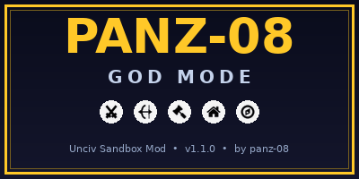
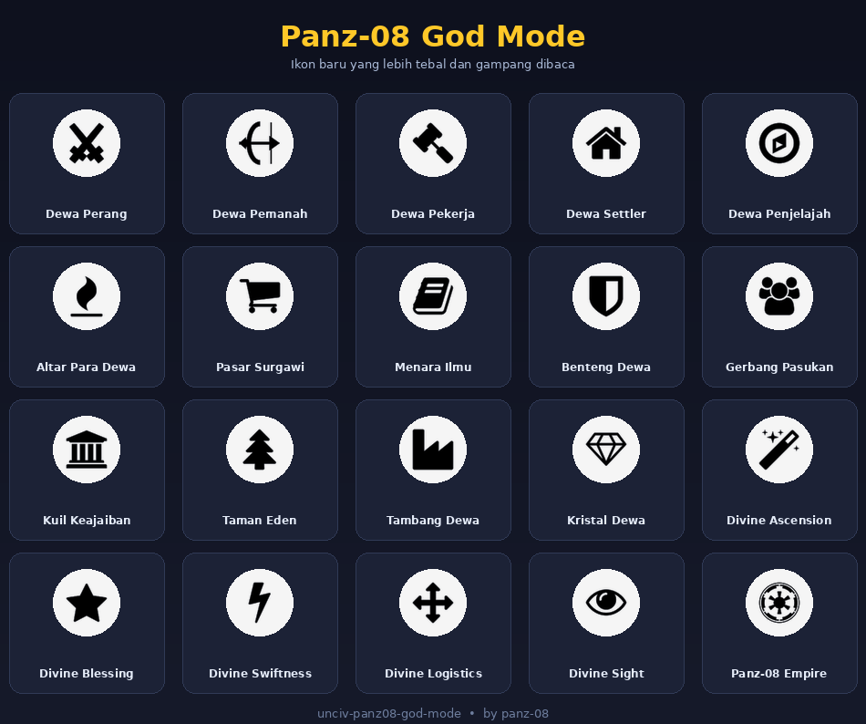

# Panz-08 God Mode



Mod sandbox alias **mode tuhan** buat Unciv. Dibuat iseng tapi serius sama **panz-08**.

Intinya sih gini: kamu mulai sebagai bangsa dewa yang ekonominya ngebut, unitnya sakti, dan bangunannya murah banget. Cocok kalau kamu lagi males susah-susah, pengen coba-coba strategi, atau sekadar main santai tanpa mikirin *unhappiness* dan defisit gold.

Semua isinya murni JSON ruleset Unciv. Nggak ada script aneh, nggak ada file game yang diutak-atik.

| Info | Keterangan |
|---|---|
| Versi | **1.1.0** |
| Dibuat untuk | Unciv **4.22.14-patch1** (Build 1278) |
| Tipe | Extension mod, aman digabung sama mod lain |
| Penulis | **panz-08** |

---

## Galeri ikon

Semua ikon digambar ulang di versi 1.1.0 biar tebal, jelas, dan nggak kayak bulatan gelap lagi.



---

## Cara pasang

### Opsi 1 — Download manual (paling gampang)

1. Klik tombol **Code** di halaman repo ini, pilih **Download ZIP**.
2. Ekstrak ZIP-nya.
3. Pindahkan folder hasil ekstrak ke folder `mods` Unciv kamu.

Lokasi folder `mods` biasanya:

- **Windows:** `%USERPROFILE%\Documents\My Games\Unciv\mods` (atau folder `mods` di sebelah `Unciv.exe`)
- **Linux:** `~/.local/share/Unciv/mods` atau folder `mods` di sebelah file `Unciv.jar`
- **Android:** `Android/data/com.unciv.app/files/mods` (pakai file manager)

Pastikan strukturnya jadi seperti ini:

```
mods/
└── Panz-08 God Mode/
    ├── jsons/
    ├── Images/
    ├── preview.png
    └── README.md
```

> Kalau di dalam folder ada folder lagi (misalnya `unciv-panz08-god-mode-main/Panz-08 God Mode/...`), pindahkan folder `Panz-08 God Mode`-nya langsung ke `mods`.

### Opsi 2 — Clone pakai Git

```bash
cd path/ke/mods
git clone https://github.com/Panz-08/unciv-panz08-god-mode.git "Panz-08 God Mode"
```

Selesai. Kalau ada update, tinggal `git pull` di folder itu.

### Opsi 3 — Langsung dari Unciv

Unciv juga bisa ambil mod dari GitHub lewat menu **Mods** → **Download mod**. Tapi karena repo ini belum masuk daftar resmi, cara paling aman tetap dua opsi di atas.

---

## Cara main

1. Buka Unciv.
2. Masuk menu **Mods**, centang **Panz-08 God Mode**.
3. Pilih **New Game**.
4. Atur seperti ini:
   - **Nation:** `Panz-08 Empire`
   - **Difficulty:** `God Mode (Panz-08)`
   - **Game Speed:** `Divine (Panz-08)`
5. Mulai.

> Mod nggak bisa ditambahkan ke save lama. Bikin game baru biar semua kontennya muncul.

Mau pakai bangsa lain? Boleh. Tetap pilih difficulty **God Mode (Panz-08)**, bonus ekonominya tetap dapat. Cuma unit dan bangunan dewa memang dikunci buat **Panz-08 Empire** doang, jadi kalau pakai bangsa lain konten itu nggak muncul.

---

## Isi mod

### Bangsa: Panz-08 Empire

Pemimpinnya **Panz-08**, gelarnya *Berkah Sang Pencipta*.

- Langsung punya teknologi **Divine Ascension** dari awal.
- Semua kota dapat **+100% Science, Production, Gold, Culture, Faith**.
- Semua unit dapat **+50% Strength**, **+2 Movement**, dan otomatis dibekali promosi **Divine Blessing**.
- Unit bisa lewat perbukitan tanpa penalti gerak.
- Ada 30 nama kota bernuansa mitologi.

### Teknologi: Divine Ascension

Teknologi pembuka khusus Panz-08. Bangsa lain nggak bisa ngeriset ini, dan nggak muncul di pohon teknologi biasa. Begitu game jalan, tekno ini udah ada di tangan.

### Unit dewa

| Unit | Kekuatan | Keistimewaan |
|---|---|---|
| **Dewa Perang** | 1000 | Gerak 6, bisa nyerang berkali-kali, kebal medan, tak terlihat, nyebrang laut tanpa embark, bisa nyerang lalu gerak |
| **Dewa Pemanah** | 300 / 1000 ranged | Jarak serang 5, nembak nembus rintangan, tak terlihat, gerak 5 |
| **Dewa Pekerja** | — | Gerak 10, bisa bangun semua improvement darat, nyebrang laut dan medan mustahil |
| **Dewa Settler** | — | Gerak 8, bisa bikin kota, nyebrang laut dan medan mustahil |
| **Dewa Penjelajah** | 100 | Gerak 10, pandangan luas, tak terlihat, bisa lihat nembus rintangan |

> Angka gerak di atas itu stat dasar. Masih ditambah bonus bangsa **+2 Movement** dan promosi **Divine Swiftness +4 Movement**, jadi aslinya jauh lebih ngebut.

Semua unit dewa juga:

- Nggak kena biaya medan dan zona kontrol.
- Bisa masuk wilayah orang tanpa Open Borders.
- Heal di mana aja, bahkan sambil jalan.
- Nggak kena penalti damage pas HP-nya tinggal sedikit.
- Bisa nyebrang laut dan tile yang normalnya nggak bisa dilewati.

### Bangunan super

| Bangunan | Efek |
|---|---|
| **Altar Para Dewa** | +20 semua yield, +10 Happiness, +25% semua stat, ngasih **Kristal Dewa**, dan unit baru dapat **Divine Blessing** |
| **Pasar Surgawi** | +100 Gold, +10 Happiness, +100% Gold, dan langsung ngasih **2500 Gold** pas selesai dibangun |
| **Menara Ilmu** | +100 Science, +100% Science, +5 poin Great Scientist & Engineer, unit baru mulai dengan 30 XP |
| **Benteng Dewa** | +25 City Strength, +5 Happiness, +100% kekuatan kota, mata-mata musuh jadi nggak guna |
| **Gerbang Pasukan** | Ngeluarin **Dewa Perang**, **Dewa Pemanah**, dan **Dewa Pekerja** gratis; +100% produksi unit militer |
| **Kuil Keajaiban** (National Wonder) | **Free Technology**, **Free Social Policy**, **Free Great Person**, buka seluruh peta, **Golden Age 15 turn**, dan **+5000 Faith** |

Semua bangunan biaya dasarnya **1 production**, tanpa maintenance, dan nggak bisa dijual. Digabung sama difficulty + speed mod ini, biayanya jadi hampir nol, jadi selesai dalam satu turn.

### Improvement dewa

| Improvement | Efek |
|---|---|
| **Taman Eden** | +10 Food, +10 Production, +10 Gold, +5 Science, +5 Culture, +5 Faith; dibangun **1 turn**, boleh di luar perbatasan, +50% pertahanan |
| **Tambang Dewa** | +20 Production, +10 Gold; dibangun **1 turn**, boleh di luar perbatasan |

Dua-duanya nggak bisa dihancurkan atau di-*pillage*.

### Resource: Kristal Dewa

Luxury resource dengan **+10 Happiness**. Nggak muncul alami di peta, tapi dikasih dari **Altar Para Dewa** dan **Pasar Surgawi**.

### Difficulty: God Mode (Panz-08)

- +100 base Happiness, +5 Happiness tiap luxury.
- Biaya riset, unit, bangunan, dan policy cuma **10%**.
- Nggak ada *unhappiness*.
- Supply unit besar banget.
- Barbarian datangnya lama.
- AI dikasih penalti besar (produksi, riset, pertumbuhan, maintenance).
- Hadiah dari barbarian camp: **500 Gold**.
- Unit awal: Dewa Settler, 2 Dewa Pekerja, Dewa Perang, Dewa Pemanah, Dewa Penjelajah.

### Speed: Divine (Panz-08)

- Biaya produksi, Gold, Science, Culture, Faith, dan improvement cuma **10%**.
- Golden Age 3x lebih lama.
- Tekanan agama kuat banget.
- Barbarian jauh lebih jarang.
- Timeline 500 turn, tapi tahunnya jalan cepat.

### Constant tambahan

- XP dari barbarian nggak ada batasnya.
- Jarak bombardir kota 4.
- Radius kerja kota 5, radius ekspansi 8.
- Ancient ruin dan natural wonder lebih banyak.
- Kota sudah kuat sejak awal.
- Upgrade unit murah banget.
- Pantheon dan agama gampang didapat.

---

## Rekomendasi main

**Mode tuhan penuh**

1. Pilih **Panz-08 Empire**.
2. Difficulty **God Mode (Panz-08)**.
3. Speed **Divine (Panz-08)**.
4. Bangun **Gerbang Pasukan** di kota pertama, langsung dapat pasukan dewa tambahan.
5. Bangun **Kuil Keajaiban** buat lompatan teknologi, policy, Great Person, dan Golden Age.
6. Sebar **Taman Eden** di sekitar kota, ekonominya jadi nggak ada lawan.

**Sandbox santai**

- Pilih bangsa apa pun, difficulty tetap **God Mode (Panz-08)**.
- Ekonomi tetap ngebut, tapi konten dewa cuma bisa dipakai Panz-08 Empire.

---

## Soal ikon (yang dulu buletan gelap)

Di versi 1.0.0 ikonnya tipis-tipis, jadi pas Unciv nge-*tint* hitam di atas lingkaran putih, hasilnya kelihatan kayak bulatan gelap. Di 1.1.0 semua ikon digambar ulang jadi **siluet putih tebal**:

- 20 ikon baru: unit, bangunan, improvement, resource, promosi, tech, dan bangsa.
- Ikon **Dewa Pemanah** digambar manual (busur + panah), bukan sekadar simbol font.
- Sudah dipak ke `Images/game.atlas` + `Images/game.png`, jadi langsung muncul tanpa perlu build apa-apa.

Kalau kamu mau ubah ikonnya sendiri:

1. Ganti file PNG di folder `Images/<Kategori>/`.
2. Masuk ke folder `Images`, lalu jalankan TexturePacker dengan setting yang sudah disediakan (`TexturePacker.settings`).
3. Atlas `game.atlas` dan `game.png` akan terbentuk ulang otomatis.

---

## Catatan teknis

- Ini **extension mod**: nambah konten ke ruleset *Civ V - Gods & Kings*, bukan ngreplace.
- Semua item dewa pakai `uniqueTo: Panz-08 Empire`, jadi AI nggak bisa mbangunnya.
- Nggak ada file game yang diubah. Hapus foldernya, mod-nya hilang total tanpa sisa.
- Kalau digabung mod lain, pastikan nggak ada nama difficulty, speed, atau tech yang bentrok.

---

## Changelog

### 1.1.0
- **Ikon dirombak total**: 20 ikon siluet putih tebal, nggak buletan gelap lagi.
- Ikon **Dewa Pemanah** digambar khusus (busur + panah).
- `preview.png` baru plus `screenshots/icons.png` buat lihat semua ikon.
- Atlas dirapikan ulang, ukuran `game.png` lebih efisien.
- README ditulis ulang, lebih santai dan jelas.

### 1.0.0
- Rilis awal.
- Bangsa Panz-08 Empire, 5 unit dewa, 6 bangunan super, 2 improvement, 1 resource, 1 tech.
- Difficulty God Mode (Panz-08), speed Divine (Panz-08), dan constant sandbox.

---

Dibikin sambil ngopi oleh **panz-08**. Kalau ada bug atau ide, buka **Issues** aja.
